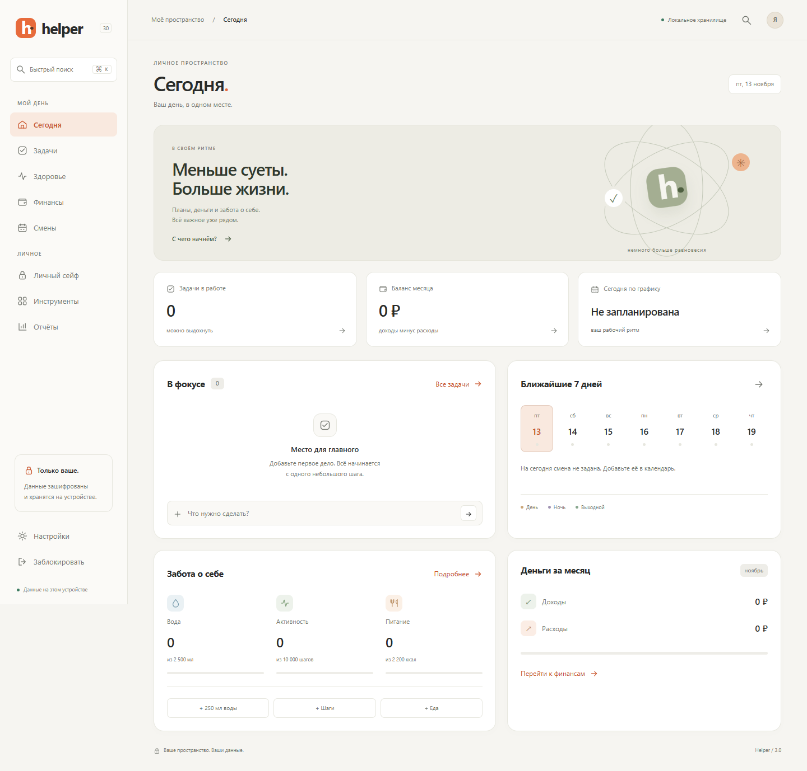
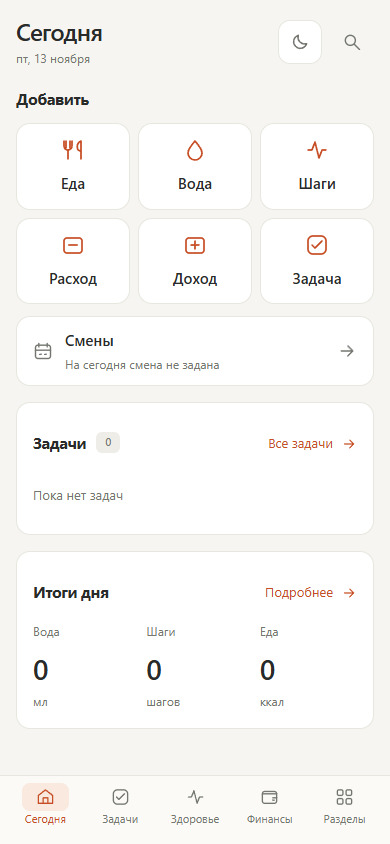
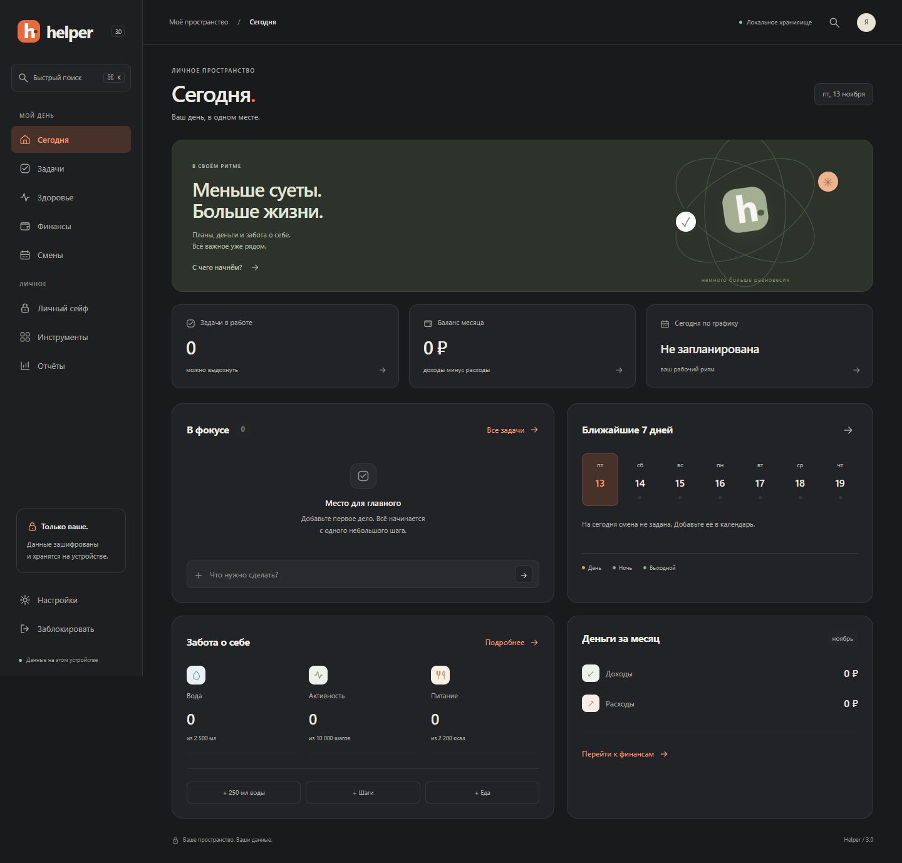

# Helper 3.1

Личное пространство для задач, здоровья, смен, финансов и паролей. Спокойный интерфейс, локальное зашифрованное хранилище и работа без сети.

[Открыть Helper](https://domovoyproj.github.io/helper-app/)



## Что изменилось

- Компактный интерфейс без баннеров, лозунгов и повторяющихся сводок. Светлая и тёмная темы.
- Четыре блока на главной: задачи, здоровье, смены и финансы. На телефоне меню «Разделы» открывает все функции напрямую.
- Вода и шаги вводятся через общую форму: готовые значения или произвольное число. Запись сохраняется за явно указанную дату. В разделе здоровья все действия находятся рядом с выбором дня.
- ИИ-оценка сначала показывает результат для проверки. Сохранение выполняется отдельной кнопкой. Ошибка сети, квота и неверный ключ имеют разные сообщения; описание не пропадает при сбое.
- Задачи с быстрым вводом, поиском и фильтрами «В работе», «Готово», «Все».
- Отдельные разделы здоровья и личного сейфа. Финансы объединяют бюджет, операции, категории и взаимные долги.
- Мобильная навигация и палитра переходов: `Ctrl+K`, `Cmd+K` или `/`. В палитре работают стрелки, Enter, Escape и Tab.
- Удалена прежняя интеграция внешней сводки долгов. Внутренний учёт долгов сохранён.
- Общие функции для создания задач, записи воды и шагов, расшифровки и восстановления бэкапов. Неверный пароль или повреждённая копия не перезаписывают текущую базу.

<details>
<summary>Мобильная и тёмная темы</summary>




</details>

## Возможности

Задачи, рабочие смены и расчёт зарплаты; бюджет, категории и долги; питание, вода, шаги, вес и настроение; анализ еды через Google Gemini; пароли и коды TOTP; отчёты CSV; резервные копии файлом и через GitHub; публичные файлы и загрузка видео.

## Запуск

Сборка и зависимости для запуска не нужны. Используйте любой статический HTTP-сервер, например Python 3:

```sh
git clone https://github.com/domovoyproj/helper-app.git
cd helper-app
python -m http.server 8765 --bind 127.0.0.1
```

Откройте `http://127.0.0.1:8765`. При первом входе задайте мастер-пароль. Существующие данные открываются прежним паролем без миграции.

Для установки PWA используйте меню браузера или кнопку в настройках, если браузер предлагает установку. Офлайн-доступ появляется после первого открытия с сетью и сохранения ресурсов.

## Данные и резервные копии

Данные сохраняются в браузере в зашифрованном контейнере `encMasterData`. Формат совместим с предыдущей версией. Мастер-пароль не отправляется на сервер. Очистка данных сайта удаляет локальную копию; заранее экспортируйте резервную копию в настройках. Восстановить забытый мастер-пароль нельзя.

Для импорта на экране входа сначала введите пароль резервной копии, затем выберите файл или GitHub. Приложение проверит расшифровку и структуру данных перед заменой текущей копии.

Сетевые функции выполняются по команде пользователя: Gemini получает описание или фото еды, GitHub — бэкап или выбранный публичный файл. TinyURL сокращает ссылки на файлы; Tikwm используется для видео. Токены входят в зашифрованную базу. Репозиторий бэкапов должен быть приватным, репозиторий файлообменника предназначен для открытых материалов.

## Если ИИ не отвечает

В «Настройки → Подключения» введите ключ и нажмите «Проверить доступ к Gemini». Проверка получает доступные модели; квота генерации проверяется при оценке блюда. Сохраните изменённый ключ кнопкой «Сохранить настройки».

`Load failed` в Safari означает, что браузер не получил ответ на сетевой запрос. Само это сообщение не определяет причину: возможны проблемы сети, фильтрации или доступа к Google API. Приложение обращается непосредственно к Google; чужие прокси не используются. Изменения интерфейса не обходят ограничения сети или аккаунта.

Клиент использует [список доступных моделей](https://ai.google.dev/api/models), [структурированный ответ generateContent](https://ai.google.dev/api/generate-content) и различает [ошибки Gemini](https://ai.google.dev/gemini-api/docs/generate-content/api-errors). Локальные проверки ответов ИИ используют фикстуры и не подтверждают квоту или доступ конкретного пользовательского ключа.

## Разработка и проверки

Нужен Node.js 22 или новее:

```sh
npm test
npm run check
```

Дополнительные браузерные проверки требуют Playwright и Chromium, а также запущенного HTTP-сервера:

```sh
node tests/browser.cjs
node tests/food-browser.cjs
```

Можно указать `HELPER_URL`, `PLAYWRIGHT_MODULE` и `CHROME_PATH`; `HELPER_BROWSER=webkit` выбирает WebKit. Браузерный тест использует отдельные временные профили, проверяет основные операции, произвольный объём воды, импорт бэкапа, блокировку и все экраны на ширинах 320, 390, 768 и 1440 px. Офлайн-навигация проверяется в Chromium: Windows WebKit в этом сценарии завершает переход внутренней ошибкой движка. WebKit на Windows не заменяет проверку на физическом iPhone. Скриншоты документации снимаются с пустым хранилищем.

- `index.html` — экраны и формы.
- `styles.css` — токены и общие компоненты; `experience.css` — сетки и навигация.
- `app.js` — операции с данными, шифрование, отчёты и внешние функции.
- `food-ai.js` — запросы Gemini, выбор модели, ошибки и проверка ответа.
- `workspace.js` — сводки, списки и взаимодействия главного экрана.
- `experience.js` — оболочка, темы и поиск разделов.
- `sw.js`, `manifest.json` — офлайн-кэш и PWA.

Для анализа связей: `graphify extract . --code-only`. Результат в `graphify-out/` не включается в Git.
